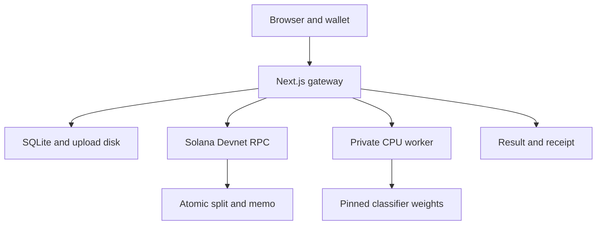
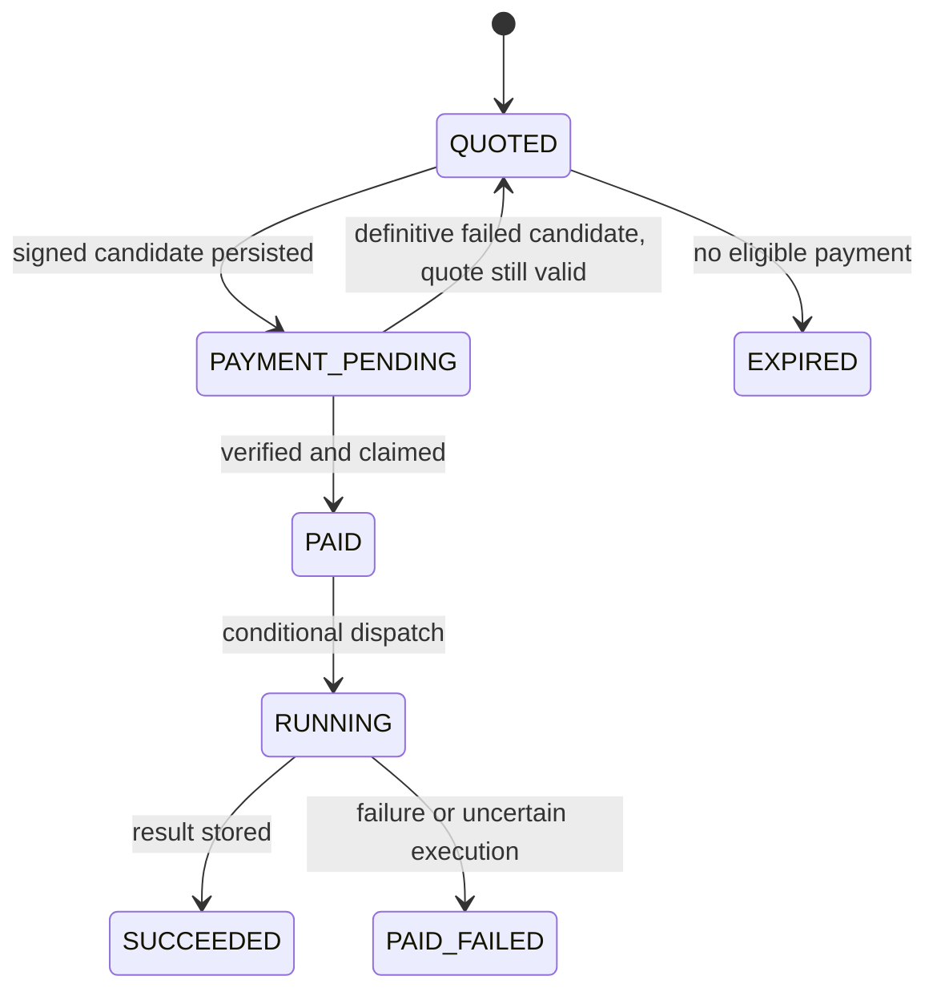

# Alloc — architecture

Specification, not deployed infrastructure. Contracts: [API](API.md); threats: [SECURITY](SECURITY.md).

## Topology

Gateway owns requests, transaction preparation/broadcast/verification, payment uniqueness, and results. Worker owns decoding, preprocessing, and computation. Browser signs; it cannot grant payment status. Solana records payment, not inference truth.

Deploy one gateway and one private worker on a Docker-capable host. SQLite and uploads share persistent host storage owned by the gateway. Worker receives image bytes over the private network, not public file URLs. Node and worker processes do not share a writable SQLite file.

## Storage model

| Record | Fields / constraints |
| --- | --- |
| requests | UUID id PK; capability_hash; payer; input_sha256; random upload path; model_id; weights_id; price_lamports; creator_address/share; provider_address/share; created_at; expires_at; state |
| payment_attempts | id PK; request_id FK; signature UNIQUE; message bytes/hash; recent_blockhash; last_valid_block_height; prepared_at; submitted_at; verification_state; verified_slot |
| fulfillments | request_id PK/FK; payment_attempt_id UNIQUE; execution_id UNIQUE; state; started_at; finished_at; result_json; error_code |
| audit_events | bounded event ID/time, request ID, state transition, reason; no bearer token or image bytes |

Store lamports as integers internally and decimal strings in JSON. Use SQLite foreign keys, WAL, busy timeout, parameterized SQL, and explicit transactions. Retain signature tombstones even when purging uploads/results. A signed transaction candidate must be recorded **before** any network broadcast.

A 256-bit random request capability is returned once; store only its hash. Require its bearer value for preparation, payment submission, status, and results. Request IDs and chain memos are public references, not authorization secrets. No account/login system is needed.

## Upload and quote

Validate size at reverse proxy and gateway, then have the private worker decode/validate without inference before quoting. Keep immutable raw bytes, hash them server-side, and use those same bytes for inference. Recheck decoded pixel limits and input hash at execution. Re-encode to RGB in memory; no metadata is put on-chain.

Readiness validation is free and performs no model forward pass. Quote persists model, price, recipients, payer, timestamps, and input digest. Require all three wallets to be distinct. A 15-minute quote can be accepted later only if an already-landed payment's recorded block time is within its window (30-second lower-bound clock tolerance). Missing block time stays pending/manual, not accepted by guessing. No new prepare/broadcast after expiry.

## Payment transaction contract

**Memo SDK compatibility note (7 November 2026):** The pinned `@solana-program/memo@0.16.0` generated builder defaults to `Memo4c2pN8afCj432Lb7RMVKi9PbQnnW7ewFFaV3oAH` (Memo v4), while Alloc's specified payment format deliberately requires the legacy `MemoSq4gqABAXKb96qnH8TysNcWxMyWCqXgDLGmfcHr` (Memo v2). The gateway therefore constructs this one v2 instruction directly with Kit's `programAddress` plus the exact UTF-8 memo bytes, and the independent byte parser enforces the legacy ID. This preserves the original contract without switching SDK families. This explicit Memo v2 instruction plus independent parser passed Node 24 CI in https://github.com/ThunderKhan/alloc/actions/runs/42325661127.

A legacy transaction with the payer as sole signer and fee payer:
1. System Program native SOL transfer: payer → creator, 7,000,000 lamports.
2. System Program native SOL transfer: payer → provider, 3,000,000 lamports.
3. Memo Program UTF-8: `alloc:v1:<request UUID>`.

Allow exactly these three top-level instructions in this order; no lookup tables, extra signers, unknown programs, or extra instructions. A wallet that modifies the message must be rejected visibly. Memo program: `MemoSq4gqABAXKb96qnH8TysNcWxMyWCqXgDLGmfcHr`; System Program: `11111111111111111111111111111111`. Resolve program builders from the compatible pinned SDK; test decoded bytes against this contract.

Gateway prepares unsigned message with fresh blockhash and last-valid block height and saves it. Wallet signs without changing message bytes. Gateway validates signature and exact message against the saved template, derives the transaction signature, durably registers it, then broadcasts those signed bytes.

Only one active candidate per request. Preparation is idempotent while its blockhash is valid. Refresh is allowed before signing, or after a submitted candidate is proven failed/expired and reconciled; never while payment outcome is unknown. Do not issue another candidate merely because an RPC timed out.

## Independent verification

Fetch the transaction from configured Devnet RPC at **confirmed** commitment using supported-version options. Null/not visible yet is pending. Require non-null metadata and no transaction execution error. Decode the actual on-chain message and require equality with the persisted prepared message, including payer signer, both exact transfers, and exact memo. Check slot against quote creation slot and block time against quote validity. Reject unsupported formats and malformed responses.

Use instruction-level checks, not just balance deltas (fees affect balances). Never trust client recipients, amounts, result payloads, or RPC endpoints. Confirmation is an explicit low-value Devnet tradeoff; finalized settlement can be inspected later and is preferable for a future real-money system.

## Claim and execution

After successful RPC verification, perform a short `BEGIN IMMEDIATE` transaction:
- If the same request already has a claim/result, return that state.
- Atomically mark candidate verified and insert one fulfillment with unique request/payment keys.
- Commit; never hold a DB write lock over RPC or model execution.

One controlled dispatcher conditionally moves `PAID → RUNNING`, commits, then invokes the private worker with execution ID and immutable bytes. Persist result before returning it. Competing callers only read state. Do not rely on an in-memory Set or a frontend disabled button.

Invalid payment submissions return errors without destroying a good quote. RPC uncertainty leaves PAYMENT_PENDING. Recovery reconciles pending payments and resumes PAID jobs that have never entered RUNNING. After gateway/worker interruption, RUNNING becomes PAID_FAILED and is **not automatically retried**.

This deliberately avoids promising exactly-once computation across distributed crashes. A worker may have computed before a gateway crashed; no reliable atomic transaction spans the database, blockchain, and model process. We guarantee durable single payment claiming and no automatic duplicate dispatch in recovery, accepting an honest paid failure instead.

## Failure and recovery boundaries

Payment may succeed while delivery fails. Receipt remains available in PAID_FAILED; no refund or retry guarantee is offered. New purchase requires user action. Disk-full fails preparation and claims closed; previously recorded candidates are reconciled after recovery. Never delete the ledger to reset the demo.

RPC fallback must be Devnet and server-configured. A fallback lookup uses the same signature, not another payment. During partitions show pending; never silently switch to mainnet or local mocks.

## Scaling after the event

Current design intentionally supports one gateway. Horizontal gateway scaling requires a shared transactional DB, durable queue, worker idempotency/recovery protocol, and object storage; SQLite on separate container disks cannot provide global replay prevention. These are future changes, not weekend tasks.
